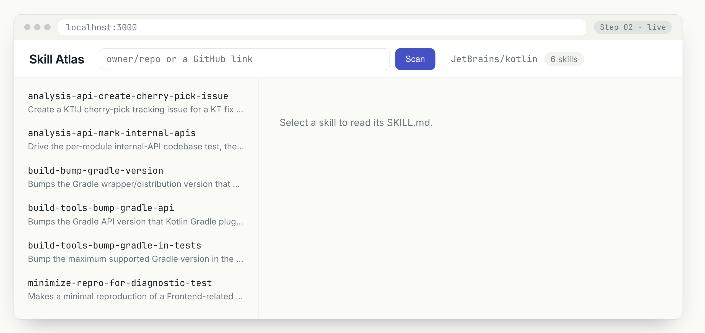
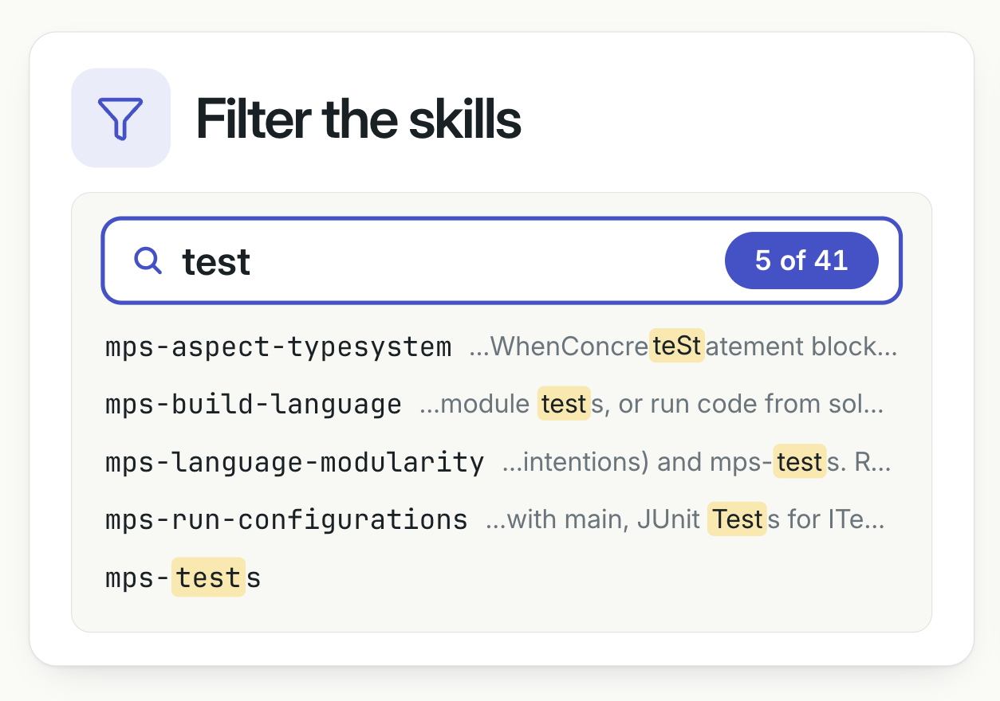
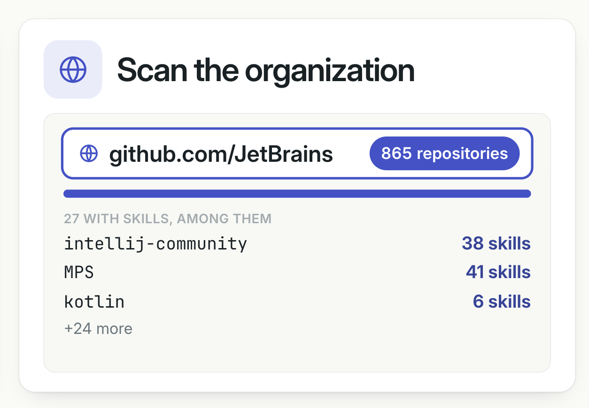

# Web
The target interface: scan a repository, then the skills on the left and the selected `SKILL.md` on the right.

## Screen
- **Header**: `Skill Atlas`, a field `owner/repo or a GitHub link` (or a local directory), **Scan**; after a scan, `owner/repo` and `N skills`; *not* the repository's last update
- **Left**: every skill, sorted by **name**; under the name, the description on *one line*, cut with `…`, then `updated <day>`, *the skill's own* ([Last updated](analysis.md#last-updated)); unknown, not shown
- **Filter**: a field `Filter the skills` over them, after a scan; see [Filter the skills](#filter-the-skills)
- **Cluster**: under the filter, the path `All skills › …` and **Cluster**, after a scan of 3 or more skills; see [Clustering](cluster.md#web)
- **Before a scan**: on the left, `Scan a repository to see its skills. Try:` and examples; see [Start](#start)
- **Right**: the selected skill's `SKILL.md`, *rendered*, with its link, **Copy link**, `also in` and `updated <day>`; before a selection, `Select a skill to read its SKILL.md.`; see [Preview](#preview), [Copy link](#copy-link)
- **URL**: what is scanned and the selected skill; see [The URL](#the-url)
- While it scans, the button is `Scanning…`, disabled
- Errors: the CLI's message, in the page, and no skills; warnings under the header
## Server
- Local only: listens on `127.0.0.1`; the token, `GITHUB_TOKEN` or gh's ([the token](cli.md)), stays on the server
- Only for `Host: localhost:<port>` or `127.0.0.1:<port>`, its own port: the page and the API; another `Host`, as a browser sends after a DNS rebinding, `403 { error }`
- `GET /` the page, with any query too, `GET /filter.js` its filter, `GET /markdown.js` and `GET /marked.js` its Markdown; `GET /api/scan?repo=<input>` → `{ repository, skills, warnings }`, each skill with its `link`, `content`, `updated`, `frontMatter` and `body` ([Preview](#preview))
- `POST /api/cluster`: one level of groups, by the model; see [Clustering](cluster.md#server)
- A clear message → `400 { error }`; *nothing is stored*
## Tests
The base scenarios end to end, in Chromium: `npm run e2e` (e2e/), with GitHub answered from a recording; `./fixture`'s dates fixed, not this checkout's commits
## Start
- Before a scan, the examples: `JetBrains/kotlin` (a repository), `github.com/JetBrains` (an organization), then `or the path to a local directory.`
- An example, clicked: typed in the field and scanned
- Hidden once scanned, an organization too; after an error, shown again
## The URL
- `?repo=<input>`, once scanned, as typed, its `/` and `:` as they are; `&skill=<name>` once a skill is selected
- Opened, reloaded or shared: the input in the field, scanned; then the skill selected; one the repository does not have, none, dropped from the URL
- Another input scanned: a new entry in the history; the same one again, or a selection: the same entry, the skill dropped by a new scan
- Back and Forward: the entry's scan again, its skill selected; the first entry, the empty page
- A scan still answering when another starts, after Back for example, or after Back to the empty page: it changes nothing
## Preview
The selected skill's `SKILL.md`, as GitHub would show it: its front matter, then its Markdown, rendered.
- **Front matter**: a small table, a row a key, in its order (`name`, `description` and the others), the value as text: a list joined with `, `, a mapping as YAML; none, no table
- Front matter YAML cannot read as a mapping: its text, *as it is*, instead of the table; no warning, it is the skill's own text
- **Markdown**: the body after the front matter, GitHub's flavor ([marked](https://marked.js.org)): headings, lists, code, tables, quotes, links, images
- Raw HTML in it: shown as *text*, not HTML
- Links: in a new tab, but `#section`; relative links and images next to the `SKILL.md`: on GitHub at the scanned commit, an image `raw/`
- `frontMatter` in `/api/scan`: `[key, value]` pairs, the YAML as text, or `null`; `body`: the Markdown after it
## Copy link
- **Copy link**, next to the selected skill's link: the link on the clipboard
- Then `Copied`, for 2 seconds; the clipboard refused: `Cannot copy`, as long
## Filter the skills

- A field over the skills: `N of M` match, by name or description, case-insensitive; empty, every skill and no count
- The text as typed, not a pattern; spaces around it ignored
- Every match highlighted, as it is written; for a description, the words around its first match: up to 20 characters before, from a word's start if there is one, cut with `…`
- A description that does not match, as it is; a skill that does not match, not listed
- The selected skill stays on the right; a new scan empties the field, an error hides it
## Scan the organization

- The same field, `github.com/<org>` (with or without `https://`): an organization, or a user, instead of a repository
- A card `Scan the organization`: `github.com/<org>` and the number of repositories; a progress bar while it scans, one repository at a time
- Then `N with skills, among them`: a few (3) repositories, the most skills first, with their `N skills`, and `+K more`, which shows the rest; with 3 or fewer, `N with skills`; with none, `No repositories with skills`
- A repository in the list: a click scans it, as `owner/repo`
- Every repository, private ones too if `GITHUB_TOKEN` sees them; its skills *counted*, from its tree at the default branch, not read
- An empty repository: no skills; a repository GitHub cannot list: a *warning*, the scan goes on; the rate limit or no GitHub at all: the message, the scan stops
- Without `GITHUB_TOKEN` or `gh auth login` ([the token](cli.md)), GitHub's rate limit allows about 60 repositories an hour
### Server
- `GET /api/organization?org=<input>` → one JSON object a line, as the scan goes: `{ organization }` with its `repositories`, the number, once listed; `{ scanned }` after each repository; then `{ organization, repositories, warnings }`, the repositories with skills
- A clear message before the first line → `400 { error }`; after it, a last line `{ error }`
- The page goes away → the scan stops asking GitHub
